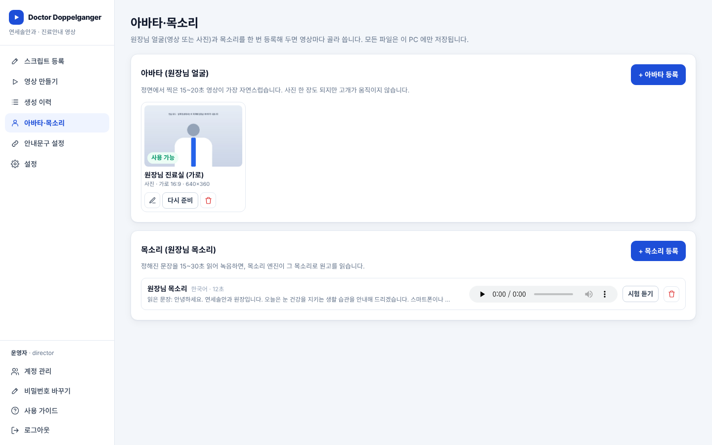
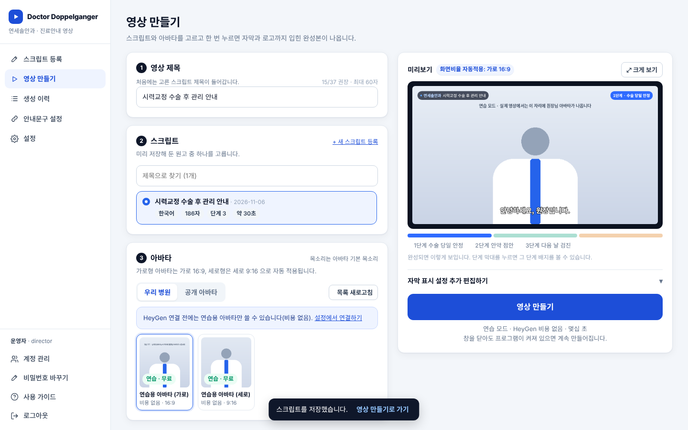
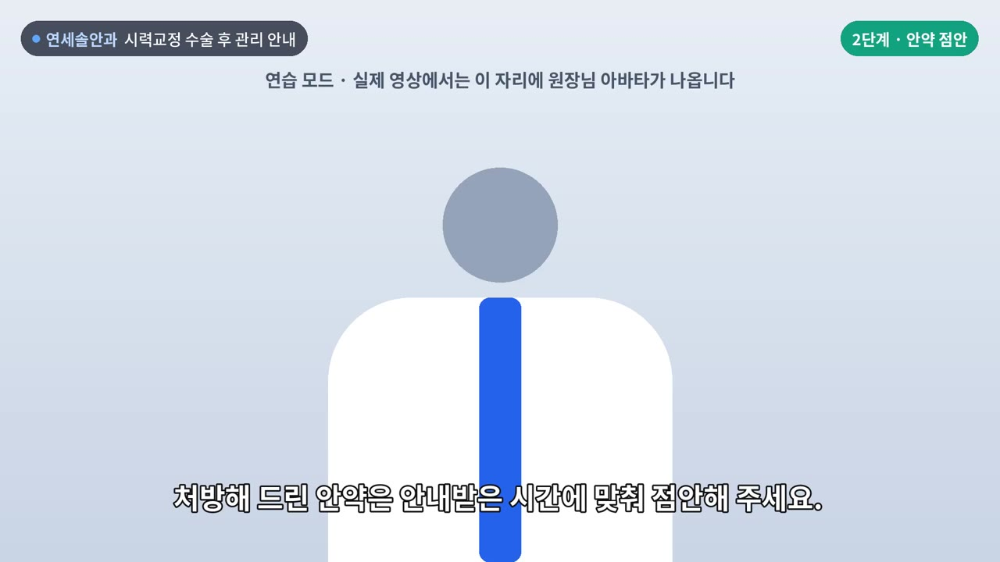

# Doctor Doppelganger · 진료안내 영상 자동화

원장님 아바타가 말하는 **진료안내 영상**을 **병원 PC 안에서 직접** 만드는 웹 프로그램입니다.
HeyGen 같은 외부 유료 서비스에 기대지 않습니다. 인터넷은 처음 설치할 때 모델을 내려받는 데만 쓰고,
원장님 얼굴·목소리·원고·영상은 모두 이 PC 의 `data` 폴더에만 저장됩니다.

| 아바타·목소리 등록 | 영상 만들기 | 완성 영상 예시 (연습용 아바타) |
|---|---|---|
|  |  |  |

## 어떻게 만들어지나요?

```
① 원장님 목소리   원고를 한 문장씩 원장님 목소리로 읽음 ── Qwen3-TTS (목소리 흉내, 15~30초 녹음으로)
   (또는 직접 녹음)  단계마다 원장님이 직접 녹음한 파일을 정리
② 입모양 맞추기   원장님이 찍어 둔 15~20초 영상의 입모양만 새 음성에 맞게 다시 그림 ── MuseTalk 1.5
③ 꾸미기 입히기   병원명·단계 배지·하단 자막·로고를 정확한 말 시점에 맞춰 합성 ── Pillow + ffmpeg
```

문장 단위로 음성을 만들기 때문에 자막이 말하는 시점에 정확히 맞습니다.

## 할 수 있는 일

- **스크립트 등록** — 원고를 붙여넣으면 빈 줄마다 단계(최대 4단계)로 나뉩니다. SRT·백업 불러오기, 복제, 다국어, (선택) Claude AI 원고 초안·번역.
- **아바타·목소리** — 원장님 영상(또는 사진)과 목소리 녹음을 한 번 등록. 브라우저에서 바로 녹음할 수 있고 「시험 듣기」로 목소리를 확인합니다.
- **영상 만들기** — 스크립트·아바타·목소리를 고르고 한 번 누르면 끝. 목소리는 ① 등록한 목소리로 읽기 ② 단계별 직접 녹음 ③ 소리 없이(연습) 중 선택. 입모양 맞추기는 켜고 끌 수 있습니다.
- **생성 이력** — 재생, mp4 내려받기, 환자용 공유 링크, **꾸미기 바꾸기**(자막만 다시, 몇 분), 대사 고쳐 다시 만들기, 실패한 단계부터 이어서 다시 시도.
- **안내문구 설정 · 설정 · 계정 관리** — 환자 화면 문구와 AI 고지, 병원명·로고·자막 기본값·글꼴·언어, 직원 계정(운영자/담당자).

## 미리 알아 두실 점 (솔직하게)

- **화질은 HeyGen 같은 유료 서비스보다 떨어집니다.** 입 주변이 약간 흐리거나 떨려 보일 수 있습니다. 공개 모델의 한계입니다. 정면에서 밝게, 고정해서 찍은 원본일수록 결과가 좋습니다.
- **NVIDIA 그래픽카드가 필요합니다** (8GB 이상). RTX 4080(16GB)처럼 메모리가 12GB 이상이면 고품질 목소리 모델(1.7B)과 더 빠른 설정이 자동으로 쓰입니다. 그래픽카드 없이도 돌아가긴 하지만 영상 하나에 몇 시간 걸릴 수 있습니다.
- 속도는 그래픽카드에 따라 다릅니다. 대략 **영상 1분에 5~15분** 정도로 생각해 주세요 (RTX 4080 이면 짧은 쪽). 만드는 동안 PC 를 다른 무거운 작업에 쓰지 않는 게 좋습니다.
- 엔진이 설치되기 전에도 「직접 녹음」 + 「입모양 없이」(아바타 영상 반복) 또는 「연습용 아바타」로 화면과 자막은 모두 시험할 수 있습니다.

---

## 설치 (Windows, 처음 한 번)

준비물: Windows 10/11 · NVIDIA 그래픽카드(8GB 이상, RTX 4080 같은 12GB 이상 권장) · 저장공간 25GB 이상 · 인터넷(설치할 때만)

> 그래픽카드가 달린 업무용 PC 에 설치하세요. EMR 이 돌아가는 병원 서버 PC 처럼 중요한 PC 에는 설치하지 않는 것이 안전합니다.

### 1단계 · 파이썬 3.12 설치
영상 엔진(PyTorch)은 **파이썬 3.10~3.13** 에서만 설치됩니다. **3.12 를 권장**합니다.
1. https://www.python.org/downloads/windows/ 에서 **Python 3.12.10** 항목을 찾아 **Download Windows installer (64-bit)** 를 누릅니다.
   (3.12 중 설치 파일이 있는 마지막 버전입니다. 맨 위의 최신 버전(3.14 등)이 아닙니다.)
2. 설치 첫 화면 아래의 **「Add python.exe to PATH」에 꼭 체크**하고 설치합니다. ← 가장 많이 놓치는 부분입니다.
3. 확인: 시작 메뉴에서 `cmd` 를 열고 `py -3.12 --version` 을 입력해 `Python 3.12.x` 가 나오면 성공.

> **이미 3.14 같은 최신 파이썬이 깔려 있어도 지우지 마세요.** 3.12 를 함께 설치하면 됩니다.
> `run.bat` 과 `install_engines.bat` 이 `py -3.12` 로 3.12 를 골라 씁니다.

### 2단계 · ffmpeg 설치 (음성·영상 처리, 필수)
`cmd` 에서 한 줄:
```
winget install --id Gyan.FFmpeg -e
```
설치 후 **명령창을 새로 열고** `ffmpeg -version` 이 나오면 성공입니다.
`winget` 이 안 되면 https://www.gyan.dev/ffmpeg/builds/ 에서 `ffmpeg-release-essentials.zip` 을 받아 압축을 풀고,
그 안의 `bin` 폴더를 이 프로그램 폴더 안에 `ffmpeg\bin` 이 되도록 넣어도 됩니다.

### 3단계 · NVIDIA 드라이버 확인
`cmd` 에서 `nvidia-smi` 를 입력해 그래픽카드 이름이 나오면 됩니다. 안 나오거나 오래된 드라이버면
https://www.nvidia.com/drivers 에서 최신 드라이버를 설치하고 PC 를 다시 켜 주세요.

### 4단계 · 프로그램 받기
- GitHub 페이지에서 **Code → Download ZIP** 으로 받아 압축을 풀거나,
- `git clone https://github.com/totenhaft/DoctorDoppleganger-Claude-.git`

> 폴더 경로는 `C:\dd` 처럼 **짧은 영문 경로**를 권합니다. 엔진 설치물 경로가 길어지면 윈도우에서 문제가 생길 수 있습니다.

### 5단계 · 웹 프로그램 실행
프로그램 폴더의 **`run.bat` 을 더블클릭**합니다.
- 처음 한 번은 필요한 패키지를 설치하느라 1~2분 걸립니다.
- 브라우저가 열리며 `http://127.0.0.1:8000` 이 뜹니다. 첫 화면에서 병원명과 **운영자(원장님) 계정**을 만듭니다.
- **검은 명령창을 닫으면 프로그램이 꺼집니다.** 영상을 만드는 동안에는 켜 두세요.

### 6단계 · 영상 엔진 설치 (목소리·입모양, 약 10~12GB · 20~60분)
프로그램 폴더의 **`install_engines.bat` 을 더블클릭**합니다.
- 엔진 전용 파이썬 환경(`engines\.venv`)을 따로 만들고, PyTorch(CUDA)·목소리·입모양 모델을 받습니다.
- 그래픽카드 메모리가 12GB 이상이면 고품질 목소리 모델(1.7B, 약 4.5GB)을, 아니면 가벼운 모델(0.6B, 약 2.5GB)을 받습니다. 둘 다 받으려면 명령창에서 `python engines\install.py --tts both`.
- 중간에 끊겨도 다시 실행하면 이어서 받습니다.
- 끝나면 웹 프로그램의 **설정 → 영상 엔진**에서 「다시 확인」을 눌러 「준비됨」이 뜨는지 확인합니다.

### 7단계 · 원장님 아바타와 목소리 등록 (메뉴: 아바타·목소리)

**아바타 영상 찍는 법** (휴대폰도 충분합니다)
- 정면, 가슴 위까지. 얼굴이 화면 높이의 1/3 이상
- 삼각대·거치대로 고정, 밝고 고른 조명 (역광·안경 반사 피하기)
- 15~20초 동안 고개를 크게 움직이지 말고, 입은 가볍게 다물거나 조용히 말하듯이
- 가로로 찍으면 가로(16:9), 세로로 찍으면 세로(9:16, 쇼츠용) 영상이 됩니다
- 올리면 **입모양 준비**가 자동으로 시작됩니다 (몇 분, 아바타마다 한 번)

**목소리 녹음하는 법**
- 화면에 나오는 문장을 평소 진료 말투로 또박또박 15~30초 읽습니다 (브라우저에서 바로 녹음 가능)
- 조용한 방, 마이크(휴대폰)와 20~30cm. 에어컨·음악 소리가 들어가면 그 잡음까지 따라 합니다
- 「읽은 문장」 칸은 실제로 읽은 내용과 똑같아야 목소리가 잘 닮습니다
- 저장 후 「시험 듣기」로 확인합니다

## 사용 순서

1. **스크립트 등록** → 원고 붙여넣기 → 저장. 빈 줄로 나눈 문단이 한 단계, 문단 첫 줄이 짧으면 단계 제목(배지에만 나오고 읽지 않음).
   - **문장 끝에 마침표를 꼭** 넣어 주세요. 숫자·영어 약어는 소리 나는 대로 적으면 더 정확히 읽습니다 (예: 5mm → 오 밀리미터).
2. **영상 만들기** → 스크립트·아바타·목소리 선택 → 미리보기 확인 → 「영상 만들기」.
3. **생성 이력** → 재생·내려받기·공유 링크. 자막이 어색하면 「꾸미기 바꾸기」(음성·입모양은 그대로, 몇 분).

프로그램 안의 `사용 가이드` 메뉴에도 같은 내용이 있습니다.

---

## 사용한 공개 모델과 라이선스

모두 상업적 사용이 허용된 라이선스입니다. 각 모델의 최신 라이선스는 링크에서 한 번 더 확인해 주세요.

| 용도 | 모델 | 라이선스 |
|---|---|---|
| 목소리 흉내 (한국어 포함 10개 언어) | [Qwen3-TTS-12Hz-1.7B-Base / 0.6B-Base](https://github.com/QwenLM/Qwen3-TTS) | Apache-2.0 |
| 입모양 | [MuseTalk 1.5](https://github.com/TMElyralab/MuseTalk) | 코드 MIT · 모델 상업 이용 허용 |
| 입모양 보조 | sd-vae-ft-mse · whisper-tiny · face-parsing(BiSeNet) | MIT |
| 얼굴 랜드마크 | DWPose (ONNX) | Apache-2.0 |
| 얼굴 찾기 | S3FD (face-alignment) | BSD-3-Clause |

> MuseTalk 은 원래 얼굴 랜드마크에 mmpose 를 쓰는데, 윈도우 설치가 어려워 같은 DWPose 모델을 ONNX 로 돌리도록 바꿨습니다 (`engines/lipsync_musetalk.py`).

## 주의할 점

- **AI 고지**: 환자 공유 페이지에는 「AI 로 만든 가상 인물」 고지가 항상 보입니다. 영상을 다른 곳에 올릴 때도 설명란 등에 AI 생성 사실을 적어 주세요.
- **본인 동의**: 아바타·목소리는 원장님 본인이거나 당사자 동의를 받은 얼굴·목소리로만 만들어 주세요. 등록 화면에서 확인을 받습니다.
- **의료광고**: SNS·유튜브에 홍보 목적으로 올리면 의료광고 심의 대상인지 확인이 필요할 수 있습니다.
- **개인정보**: 원고·AI 제안 칸에 환자 이름·연락처·주민등록번호를 넣지 마세요.

## 환자에게 링크 보내기

공유 링크는 이 PC 가 영상을 직접 보내 주는 방식이라, **환자 휴대폰에서 열리려면 이 PC 가 인터넷에서 보여야** 합니다.

1. **가장 쉬움 (추천)** — 생성 이력에서 mp4 를 내려받아 유튜브에 **「일부 공개」**로 올리고 그 링크를 보냅니다.
2. **병원 안에서만** — `run.bat --lan` (또는 `python run.py --lan`) 으로 켜면 같은 내부망의 PC·태블릿에서 `http://이PC의IP:8000` 으로 열립니다. 대기실 태블릿 상영 등에 좋습니다. (다른 PC 에서는 브라우저 녹음 대신 파일 올리기를 쓰세요.)
3. **인터넷 공개 주소 (중급)** — Cloudflare Tunnel 같은 도구로 공개 주소를 붙이고 `설정 → 공유 링크 주소`에 넣습니다. 이 경우 로그인 화면도 인터넷에 노출되므로 모든 계정에 강한 비밀번호를 쓰고, 병원 보안 장비 정책을 먼저 확인하세요.

## 데이터와 백업

- 모든 병원 데이터는 `data/` 에 있습니다: `app.db`(계정·원고·설정), `avatars/`(원장님 영상·준비 자료), `voices/`(목소리 녹음), `videos/`(영상), `logs/`(엔진 실행 기록).
- **백업은 `data` 폴더를 통째로 복사**하면 됩니다 (프로그램을 끈 상태에서).
- `data/` 와 엔진 설치물(`engines/.venv`, `engines/MuseTalk`, `engines/models`)은 `.gitignore` 에 들어 있어 GitHub 에 올라가지 않습니다.
- **API 키나 비밀번호를 코드 파일에 적거나 채팅·메신저에 붙여넣지 마세요.**

## 자주 생기는 문제

| 증상 | 해결 |
|---|---|
| `python` 을 찾을 수 없다 | 파이썬 설치 때 「Add python.exe to PATH」를 빠뜨린 경우. 설치 파일 다시 실행 → Modify → PATH 추가 |
| 「영상 엔진은 파이썬 3.10~3.13 에서만…」 | 파이썬 3.14 등 최신 버전만 있는 경우. 1단계대로 3.12 를 함께 설치하고 install_engines.bat 다시 실행 |
| 「ffmpeg 을(를) 찾지 못했습니다」 | 2단계 확인. winget 설치 직후라면 **명령창·run.bat 을 새로 열어야** 인식됩니다 |
| install_engines.bat 이 중간에 멈춤 | 인터넷 연결 확인 후 다시 실행 (받은 부분은 건너뜀) |
| 설정 → 영상 엔진에 「그래픽카드 못 찾음」 | NVIDIA 드라이버를 최신으로 설치하고 PC 재시작 → 「다시 확인」 |
| 「그래픽카드 메모리가 부족합니다」 | 다른 프로그램(게임·영상 편집·크롬 탭 여러 개)을 끄고, 설정 → 영상 엔진에서 「입모양 한 번에 처리할 장수」를 4장으로, 목소리 모델을 「가벼움 0.6B」로 |
| 「얼굴을 찾지 못한 화면이 많습니다」 | 정면에서 얼굴이 크게 나오게 다시 찍기 (마스크·손으로 입 가리지 않기) |
| 목소리가 어색하거나 잡음이 섞임 | 더 조용한 곳에서 다시 녹음, 「읽은 문장」을 실제 읽은 내용과 똑같이 |
| 입 주변이 흐리거나 떨림 | 원본 영상을 더 밝게·고정해서 다시 찍기. 공개 모델 특성상 어느 정도는 남습니다 |
| 영상 만들기가 실패 | 생성 이력의 「이유 보기」. 자세한 기록은 `data\logs` 폴더의 가장 최근 파일 |
| 브라우저에서 녹음이 안 됨 | 크롬·엣지에서, 이 PC 의 `http://127.0.0.1:8000` 으로 열었을 때만 마이크를 쓸 수 있습니다 (다른 PC 에서는 파일 올리기) |

> 구글 Colab 에서는 실행하지 마세요. 이 프로그램은 계속 켜져 있어야 하고 영상·모델을 PC 에 저장하는데, Colab 은 세션이 끊기면 파일이 사라집니다.

## 폴더 구조

```
run.bat / run.py        웹 프로그램 실행
install_engines.bat     영상 엔진 설치 (처음 한 번)
requirements.txt        웹 프로그램 패키지 (가벼움)
app/                    웹 서버
  main.py               화면이 쓰는 모든 API
  worker.py             작업 대기열 (아바타 준비 / 1 음성 → 2 입모양 → 3 꾸미기)
  engines.py            엔진 실행·상태 확인 (엔진은 별도 파이썬 환경에서 실행)
  media.py              음성 이어 붙이기, 아바타 원본 다듬기 (ffmpeg)
  compose.py            자막·배지·로고 합성 (Pillow + ffmpeg)
  timing.py             문장 나누기, 자막 조각 나누기
  ai.py                 Claude 원고 초안·번역 (선택)
engines/                영상 엔진 (별도 파이썬 환경 engines/.venv)
  install.py            설치 스크립트
  tts_qwen.py           목소리 엔진 실행
  lipsync_musetalk.py   입모양 엔진 실행 (아바타 준비 / 입모양 맞추기)
  check.py              엔진 상태 점검
static/                 화면 (index.html, app.css, js/)
data/                   ← 실행하면 생김. 병원 데이터. GitHub 에 올라가지 않음
```
