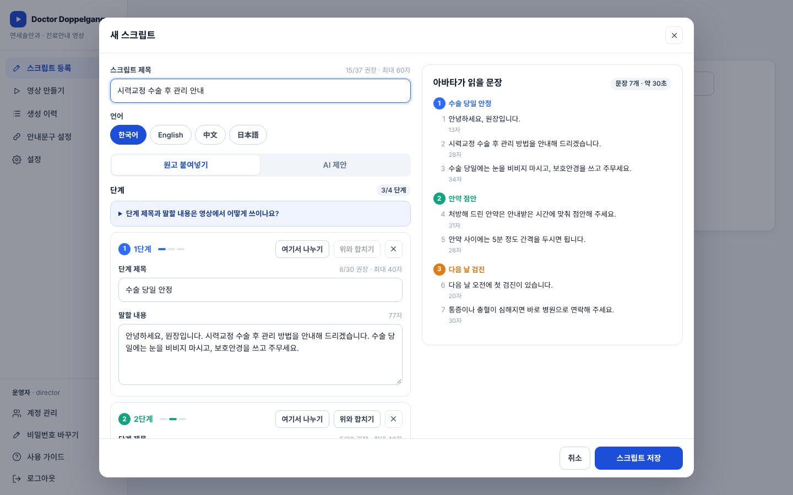

# Doctor Doppelganger · 진료안내 영상 자동화

원장님 아바타가 말하는 **진료안내 영상**을 병원 PC 에서 자동으로 만드는 웹 프로그램입니다.
원고를 붙여넣고 아바타를 고르면 **HeyGen** 이 아바타 영상을 만들고, 이 프로그램이 병원명·단계 배지·하단 자막·로고를 입혀 완성본(mp4)을 만듭니다. 완성된 영상은 환자용 공유 링크로 보낼 수 있습니다.

| 스크립트 등록 | 영상 만들기 | 완성 영상 예시 (연습 모드) |
|---|---|---|
|  |  |  |

## 할 수 있는 일

- **스크립트 등록** — 원고를 붙여넣으면 빈 줄마다 단계(최대 4단계)로 나뉩니다. SRT 자막 파일·백업(JSON) 불러오기, 복제, 백업, 다국어, (선택) Claude AI 원고 초안·번역.
- **영상 만들기** — 스크립트와 아바타를 고르고 한 번 누르면 끝. 가로(16:9)/세로(9:16)는 아바타에 맞춰 자동. 실제 영상과 같은 틀의 미리보기에서 자막 글꼴·크기·색·외곽선·그림자·박스·위치를 조정.
- **생성 이력** — 재생, mp4 내려받기, 환자용 공유 링크, **꾸미기 바꾸기**(아바타 비용 없이 자막만 다시), 대사 고쳐 다시 만들기, 대기열·대기 취소, 실패 이유 보기.
- **안내문구 설정** — 환자가 링크를 열었을 때 보이는 문구와 **AI 고지 문구**(인공지능 기본법 대응).
- **설정 / 계정 관리** — HeyGen 연결·잔액 확인, 병원명·로고, 병원 기본 자막, 글꼴 업로드, 언어, 직원 계정(운영자/담당자) 초대·잠금 해제·비밀번호 재설정.
- **연습 모드** — HeyGen 연결 전에도 「연습용 아바타」로 자막·로고 합성을 **무료로** 시험할 수 있습니다.

## 어떻게 동작하나요?

```
원고 ──▶ ① HeyGen API: 아바타가 말하는 영상 + 말한 시점이 담긴 SRT 자막
     ──▶ ② 말하는 시점 맞추기: 원고 문장 ↔ SRT 를 글자 단위로 맞춰 문장별 시각 계산
     ──▶ ③ 꾸미기 입히기: Pillow 로 배지·자막·로고 그림 → ffmpeg 로 정해진 시간에 겹쳐 mp4
```

- 화면: `static/` (HTML·CSS·자바스크립트, 빌드 과정 없음)
- 서버: `app/` (파이썬 FastAPI)
- 데이터: `data/` 폴더 하나에 모두 저장 (SQLite 데이터베이스 + 영상 파일). **GitHub 에 올라가지 않습니다.**

---

## 설치 (Windows, 처음 한 번)

### 1단계 · 파이썬 설치
1. https://www.python.org/downloads/ 에서 **Python 3.12** (3.10 이상이면 됨)를 내려받습니다.
2. 설치 첫 화면 아래의 **「Add python.exe to PATH」에 꼭 체크**하고 설치합니다. ← 초보자가 가장 많이 놓치는 부분입니다.
3. 확인: 시작 메뉴에서 `cmd` 를 열고 `python --version` 을 입력해 버전이 나오면 성공.

### 2단계 · ffmpeg 설치 (영상 합성용, 필수)
가장 쉬운 방법 — `cmd` 에서 한 줄:
```
winget install --id Gyan.FFmpeg -e
```
설치 후 **명령창을 새로 열고** `ffmpeg -version` 이 나오면 성공입니다.

`winget` 이 안 되면: https://www.gyan.dev/ffmpeg/builds/ 에서 `ffmpeg-release-essentials.zip` 을 받아 압축을 풀고,
그 안의 `bin` 폴더를 이 프로그램 폴더 안에 `ffmpeg\bin` 이 되도록 넣어도 됩니다. (`ffmpeg\bin\ffmpeg.exe`)

### 3단계 · 프로그램 받기
- GitHub 페이지에서 **Code → Download ZIP** 으로 받아 압축을 풀거나,
- git 을 쓴다면 `git clone https://github.com/totenhaft/DoctorDoppleganger-Claude-.git`

> 폴더 경로에 한글이 있어도 동작하지만, 문제가 생기면 `C:\dd` 처럼 짧은 영문 경로로 옮겨 보세요.

### 4단계 · 실행
프로그램 폴더의 **`run.bat` 을 더블클릭**합니다.
- 처음 한 번은 필요한 패키지를 설치하느라 몇 분 걸립니다(인터넷 필요).
- 잠시 뒤 브라우저가 열리며 `http://127.0.0.1:8000` 이 뜹니다.
- **검은 명령창을 닫으면 프로그램이 꺼집니다.** 영상을 만드는 동안에는 켜 두세요.

직접 실행하고 싶다면(주피터·VS Code 터미널 등):
```
pip install -r requirements.txt
python run.py
```

### 5단계 · 처음 설정
1. 첫 화면에서 병원명과 **운영자(원장님) 계정**을 만듭니다.
2. HeyGen 사이트(https://app.heygen.com)에서 **원장님 아바타**를 먼저 만들어 둡니다 (디지털 트윈 또는 포토 아바타). 아바타와 목소리는 HeyGen 에 있어야 목록에 나옵니다.
3. HeyGen 에서 **API 키**를 발급받아 `설정 → HeyGen 연결`에 넣고 「저장하고 연결 확인」.
4. `설정 → 브랜딩`에서 로고(투명 배경 PNG)를 올리고, `병원 기본 자막 설정`을 정한 뒤 「설정 저장」.
5. 직원이 쓸 경우 `계정 관리`에서 담당자 계정을 초대합니다 (임시 비밀번호는 직접 전달).

## 사용 순서

1. **스크립트 등록** → 「+ 신규 등록」 → 원고 붙여넣기 → 제목 입력 → 저장
   - 빈 줄로 나눈 문단 = 한 단계 / 문단 첫 줄이 짧으면 = 단계 제목(배지에만 나오고 읽지 않음)
   - **문장 끝에 마침표를 꼭** 넣어 주세요. 자막이 문장 단위로 자연스럽게 나뉩니다.
2. **영상 만들기** → 스크립트·아바타 선택 → 미리보기 확인 → 「영상 만들기」 (보통 5~10분)
3. **생성 이력** → 재생·내려받기·공유 링크. 자막이 어색하면 「꾸미기 바꾸기」(비용 없음).

프로그램 안의 `사용 가이드` 메뉴에도 같은 내용이 있습니다.

---

## 비용과 주의할 점

- **HeyGen 은 유료입니다.** 영상 만들기를 누를 때마다(대사 고쳐 다시 만들기 포함) HeyGen 요금이 듭니다. 요금제·잔액은 HeyGen 사이트와 `설정 → HeyGen 연결`에서 확인하세요. 「꾸미기 바꾸기」와 「연습 모드」는 HeyGen 비용이 들지 않습니다.
- 실수로 긴 영상이 만들어지지 않도록 원고 예상 길이가 **5분(300초)** 을 넘으면 만들지 않습니다. 바꾸려면 `app/config.py` 의 `MAX_VIDEO_SECONDS`.
- 같은 영상이 두 번 결제되지 않도록 HeyGen 요청에 `Idempotency-Key` 를 붙입니다.
- **AI 고지**: 환자 공유 페이지에는 「AI 로 만든 가상 인물」 고지가 항상 보입니다. 영상을 다른 곳에 올릴 때도 설명란 등에 AI 생성 사실을 적어 주세요.
- **의료광고**: 진료 안내 영상이라도 SNS·유튜브에 홍보 목적으로 올리면 의료광고 심의 대상인지 확인이 필요할 수 있습니다.
- **개인정보**: 원고·AI 제안 칸에 환자 이름·연락처·주민등록번호를 넣지 마세요.
- 아바타는 **본인(원장님)이 동의한** 얼굴·목소리로만 만들어 주세요.

## 환자에게 링크 보내기

공유 링크는 이 PC 가 영상을 직접 보내 주는 방식이라, **환자 휴대폰에서 열리려면 이 PC 가 인터넷에서 보여야** 합니다. 방법은 셋입니다.

1. **가장 쉬움 (추천)** — 생성 이력에서 mp4 를 내려받아 유튜브에 **「일부 공개」**로 올리고 그 링크를 문자로 보냅니다.
2. **병원 안에서만** — `run.bat --lan` (또는 `python run.py --lan`)으로 켜면 같은 와이파이·내부망의 PC·태블릿에서 `http://이PC의IP:8000` 으로 열립니다. 대기실 태블릿 상영 등에 좋습니다.
3. **인터넷 공개 주소 만들기 (중급)** — Cloudflare Tunnel 같은 도구로 이 PC 에 공개 주소를 붙인 뒤, 그 주소를 `설정 → 공유 링크 주소`에 넣습니다.
   - 이렇게 하면 **로그인 화면도 인터넷에 노출**되므로 모든 계정에 강한 비밀번호를 쓰세요(5번 틀리면 자동 잠김).
   - 병원 네트워크 보안 장비(방화벽) 정책과 충돌할 수 있으니 설치 업체와 먼저 상의하세요.

## 데이터와 백업

- 모든 데이터는 프로그램 폴더의 `data/` 에 있습니다: `app.db`(계정·원고·설정·**API 키**), `videos/`(영상), `logo/`, `fonts/`.
- **백업은 `data` 폴더를 통째로 복사**하면 됩니다. 프로그램을 끈 상태에서 복사하세요.
- API 키는 `data/app.db` 에 저장되고 화면(브라우저)으로는 절대 보내지 않습니다. 대신 이 PC 에 접근할 수 있는 사람은 읽을 수 있으니 PC 잠금을 켜 두세요.
- `data/` 는 `.gitignore` 에 들어 있어 GitHub 에 올라가지 않습니다. **API 키나 비밀번호를 코드 파일에 직접 적거나 채팅·메신저에 붙여넣지 마세요.**

## 자주 생기는 문제

| 증상 | 해결 |
|---|---|
| `python` 을 찾을 수 없다 | 파이썬 설치 때 「Add python.exe to PATH」를 빠뜨린 경우. 파이썬 설치 파일을 다시 실행 → Modify → PATH 추가, 또는 재설치 |
| 「ffmpeg 을(를) 찾지 못했습니다」 | 2단계를 다시 확인. winget 설치 직후라면 **명령창·run.bat 을 새로 열어야** 인식됩니다 |
| 브라우저에 「연결할 수 없음」 | 검은 명령창이 켜져 있는지 확인. 다른 프로그램이 8000 포트를 쓰면 `python run.py --port 8010` |
| HeyGen 「API 키가 맞지 않습니다」(401) | 키를 다시 복사해 넣기 (앞뒤 공백 주의) |
| HeyGen 「요청을 거절했습니다」(403) | HeyGen 요금제에서 API 사용이 가능한지 확인 |
| 「HeyGen 서버에 연결하지 못했습니다」 | 인터넷 연결, 병원 방화벽에서 `api.heygen.com` 이 막혀 있지 않은지 확인 |
| 아바타 목록이 비어 있다 | HeyGen 에서 아바타를 먼저 만들고 「목록 새로고침」. 아직 만드는 중(처리 중)인 아바타는 나오지 않습니다 |
| 자막 글꼴이 마음에 안 든다 | `fonts/README.md` 대로 Pretendard 를 넣거나, `설정 → 글꼴 업로드` |
| 영상 만들기가 실패 | 생성 이력에서 「이유 보기」. 아바타 영상이 저장돼 있으면 「꾸미기만 다시 시도」(비용 없음) |

> 구글 Colab 에서는 실행하지 마세요. 이 프로그램은 계속 켜져 있어야 하고 영상 파일을 PC 에 저장하는데, Colab 은 세션이 끊기면 파일이 사라집니다.

## 폴더 구조

```
run.bat / run.py      실행 파일
requirements.txt      필요한 파이썬 패키지
app/
  main.py             웹 서버 · 모든 API
  worker.py           영상 만들기 대기열 (1/3 아바타 → 2/3 시점 맞추기 → 3/3 꾸미기)
  heygen.py           HeyGen API v3 연결
  timing.py           원고 ↔ SRT 시점 맞추기, 자막 나누기
  compose.py          Pillow + ffmpeg 합성
  demo.py             연습 모드 영상
  ai.py               Claude 원고 초안·번역 (선택)
  auth.py / db.py     로그인 · 데이터베이스
  config.py           경로 · 제한값
static/               화면 (index.html, app.css, js/)
fonts/                (선택) Pretendard 글꼴을 넣는 곳
data/                 ← 실행하면 생김. 병원 데이터. GitHub 에 올라가지 않음
```

## 참고

- HeyGen API 문서: https://developers.heygen.com (이 프로그램은 2026년 11월 기준 v3 API 를 씁니다. HeyGen 이 API 를 바꾸면 `app/heygen.py` 를 고쳐야 할 수 있습니다.)
- Claude API 문서: https://docs.claude.com
